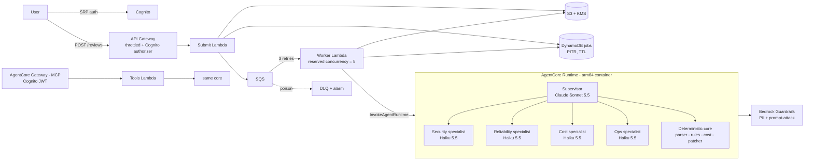

# Koththalam / ArchGuard (கொத்தளம்) — AI Well-Architected Reviewer on Amazon Bedrock AgentCore

*Koththalam* (கொத்தளம்) is Tamil for a fortress watchtower: the lookout that spots weaknesses before attackers do. *ArchGuard* is the engineering name used in code, package and stack names.

Upload a CloudFormation / CDK-synth / Terraform-plan document. ArchGuard returns a Well-Architected
review: findings mapped to pillars and best-practice IDs, a before/after cost estimate, and a
**verified** patched template (every fix is re-scanned to prove the finding is gone).

**Core design idea — deterministic detection, LLM judgement.** A rule engine decides *whether* a
misconfiguration exists, so findings cannot be hallucinated and precision/recall are measurable. Claude
models on Bedrock explain risk, prioritise, narrate trade-offs, and handle what rules cannot (residual risks).

## Architecture



| Layer | Choice | Why |
|---|---|---|
| Agent hosting | AgentCore Runtime (container) | managed sessions, isolation, tracing |
| Tools for other clients | AgentCore Gateway → Lambda (MCP) | any MCP client can reuse the scanner |
| Models | Sonnet 5.5 supervisor, Haiku 5.5 specialists, Opus 5.5 opt-in `deep` | cost per completed task |
| Safety | Guardrails (PII anonymize, prompt-attack filter), KMS, least-priv IAM, tenant isolation by Cognito `sub` | |
| Async | API → SQS → worker, DLQ, idempotent redelivery, reserved concurrency | bounded spend, no lost jobs |
| Cost guard | AWS Budgets alerts at 50/80/100 % | Bedrock bills add up |
| IaC | AWS CDK (Python), L2 AgentCore constructs | one-command deploy |

> Inside the Runtime the agents call the core in-process; the same functions are exposed through
> Gateway for external MCP clients. Wiring the agents to consume Gateway over MCP is on the roadmap.

## Quick start

```bash
pip install -e ".[agents,infra,dev]"
python benchmark/generate.py --n 40 --seed 7
pytest -q                                   # 10 tests
python -m archguard.evaluate benchmark/generated

# scan locally (no AWS needed)
python -c "from archguard.parser import parse_path; from archguard.rules import scan; \
[print(f.severity.value, f.rule_id, f.resource_id) for f in scan(parse_path('benchmark/cases'))]"

# deploy (needs AWS creds, Docker for the runtime image, Bedrock model access in us-east-1)
bash scripts/build_lambda.sh
npx aws-cdk bootstrap && npx aws-cdk deploy -c alert_email=you@domain.com -c budget_usd=25
```

## Evaluation (what is measured, and what is not)

Run `python -m archguard.evaluate benchmark/generated`.

| Set | What it is | Result |
|---|---|---|
| `benchmark/generated` | 40 seeded templates, 153 injected misconfigurations, hardened baseline gives true negatives | precision 1.00, recall 1.00 |
| `benchmark/hard` | 7 hand-written adversarial cases (port ranges, IPv6, list-form IAM, standalone SG rules, parameter indirection, managed admin ARN) | 6/6 found, 0 false positives |
| Fix verification | patched template re-scanned | 114/114 fixable findings resolved |
| Dogfood | scanner run on ArchGuard's own synthesized stack | 0 findings |

**Honest limits.** The seeded set is authored from the same rule taxonomy, so it is a regression gate,
not an estimate of real-world recall. The hard set initially exposed 3 misses (standalone
`SecurityGroupIngress`, `Ref` to parameter defaults, `AdministratorAccess` managed ARN) that were fixed —
that loop is the point. The next credible step is scoring against public vulnerable-IaC corpora
(e.g. TerraGoat / CloudGoat-style templates). Cost figures use an offline price table (see `cost.py`),
not the live Pricing API. LLM report quality is **not** yet measured (see roadmap).

## Verified vs. not yet verified

- Verified locally: parser, 20 rules, patcher, cost model, Lambda tool handler, 10 pytest tests,
  agents construct with the real Strands SDK, `cdk synth` succeeds (57 resources).
- **Not yet run:** live `cdk deploy`, real Bedrock invocations, Runtime container build. Do these
  before quoting latency, token or dollar figures anywhere.

## Roadmap (each item is a strong interview story)

1. LLM-quality eval with AgentCore batch evaluations (faithfulness: every claim ⊆ scanner findings).
2. Agents consume Gateway tools over MCP; per-identity rate limits via Gateway policies.
3. Knowledge Base of Well-Architected lenses so each finding cites whitepaper text.
4. GitHub App that opens the fix as a pull request; Step Functions for multi-file repos.
5. Read-only cross-account scan via an assumed IAM role + AWS Config.
6. Next.js dashboard on CloudFront + Cognito.
7. Deploy job in CI with GitHub OIDC (no long-lived keys).

## Repo layout

```
src/archguard/   models, parser, rules, cost, patcher, evaluate, tools_handler, agents/
agents/          AgentCore Runtime entrypoint + Dockerfile
api_handlers/    submit (API) and worker (SQS) Lambdas
infra/           CDK app + stack
benchmark/       generator, hard cases, sample template
tests/           pytest suite
```
